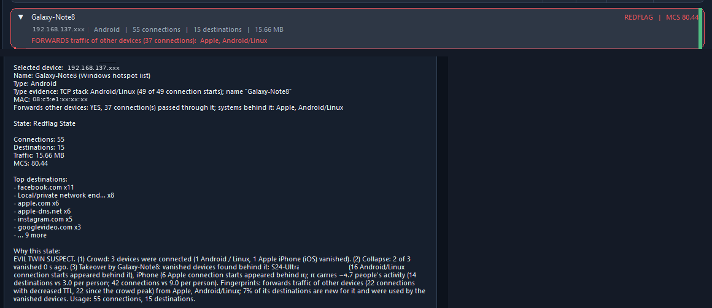
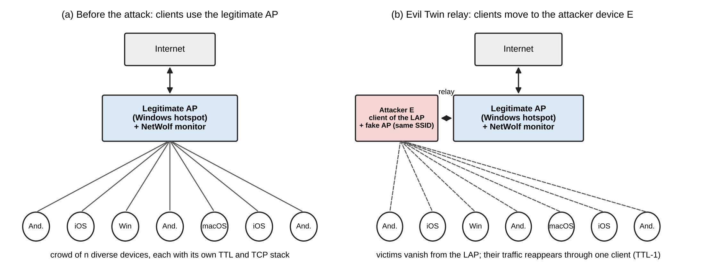
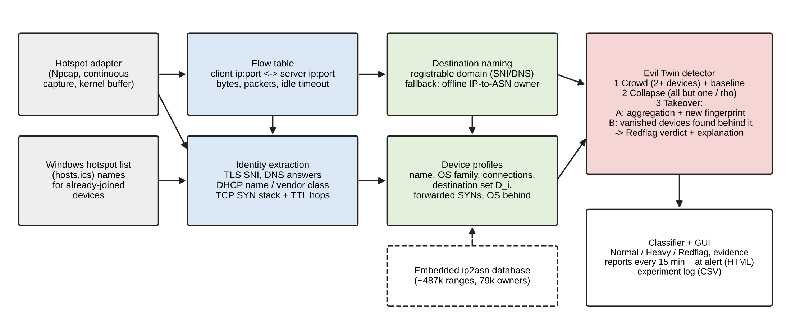

# NetWolf v2

**Detecting Evil Twin relays from the legitimate access point.**

NetWolf v2 is a Windows tool, written in C++, that runs on the computer that *is* the Wi-Fi access point (Windows Mobile Hotspot). It watches the devices connected to that hotspot and raises an alert when an **Evil Twin relay** takes them over. In this attack, someone creates a fake network with the same name, lures the other devices away, and forwards their traffic back through the real access point.

The tool needs no software on the users' phones and no extra radio hardware. It does not decrypt traffic. It reads only packet headers, DNS answers, TLS SNI and DHCP options.



*A real experiment: three phones were connected to the hotspot. A Galaxy Note 8 started Wi-Fi sharing, and the other two phones moved to it. NetWolf v2 raised the alert in the same second the collapse was confirmed. It explained why: an iPhone and a Galaxy S24 vanished, and their operating systems appeared behind the Note 8.*

---

## Contents

- [How the detection works](#how-the-detection-works)
- [Requirements](#requirements)
- [Build](#build)
- [Run](#run)
- [Reports and experiment logs](#reports-and-experiment-logs)
- [Reproducing the evaluation](#reproducing-the-evaluation)
- [Parameters](#parameters)
- [Privacy and ethics](#privacy-and-ethics)
- [Limitations](#limitations)
- [Project layout](#project-layout)
- [Paper and citation](#paper-and-citation)

---

## How the detection works



In the relay form of the attack, the Evil Twin is itself a client of the legitimate access point. From the access point, the attack looks like a change in its own client population. NetWolf v2 looks for this order of events:

1. **Crowd.** Two or more devices are connected and active. Two people are already enough: the attacker and one victim.
2. **Collapse.** Within 150 seconds, the crowd vanishes. In small crowds, all devices but one disappear. In large crowds, at least 80% disappear.
3. **Takeover.** Within 240 seconds after the collapse, one remaining device takes over the vanished devices. Either of two independent kinds of evidence confirms it:
   - **A. Aggregation.** The device carries the activity of several people (measured against the per-person baseline of the crowd and against its own usual activity), and a *new* fingerprint confirms it.
   - **B. Following the vanished devices.** The device forwards traffic, and the vanished devices are *found behind it*:
     - their **operating system** appears behind it for the first time, for example Apple connection starts behind an Android phone; or
     - **their own destinations** (apps and services the device did not use before) appear on it.

NAT hides the victims' IP addresses behind the relay. It does not hide their TCP stacks or their apps, so NetWolf v2 follows the devices, not the addresses.

**How NetWolf v2 sees through NAT.**
- **Forwarding.** A connection start (TCP SYN) whose IP TTL is one lower than a standard initial value (64, 128 or 255) has passed through the device, so the device is forwarding traffic of others.
- **Operating system of hidden devices.** The TCP options in each connection start reveal the operating system that built it: Windows, Apple, or Android/Linux.
- **Names, not lists.** Destinations are named automatically from TLS SNI and DNS answers, reduced to the registrable domain. When no name is visible, an embedded offline IP-to-ASN database supplies the owner of the address. No list of applications or companies is used anywhere.

**Protections against false alarms.**
- A device counts as present only while it **sends** packets itself. After a device leaves, servers keep retransmitting to its old address for minutes, and those packets must not make it look present.
- Forwarding that existed before the collapse does not count as new evidence. This covers a phone that always shares its connection with its own laptop, or one that always tunnels a little traffic through a VPN or an internal service.
- Popular destinations that the remaining device already used do not count as overlap.
- A device's own operating system behind it needs more evidence (10 connection starts) than a foreign one (5). A tunnel or virtual system inside a phone produces its own OS family.

Every alert is explained: which devices vanished, when, what was found behind the suspect, and which fingerprints confirmed it.



---

## Requirements

| Component | Version / note |
|---|---|
| Windows | Windows 11, 64-bit |
| Compiler | Visual Studio Build Tools with the C++ workload and "C++ CMake tools for Windows" (CMake and Ninja). `build.bat` expects Build Tools 18 (Visual Studio 2026); edit the `VCVARS` path in `build.bat` for another version. |
| Npcap | [Npcap](https://npcap.com/) runtime installed on the PC |
| Npcap SDK | Extract the [Npcap SDK](https://npcap.com/#download) to `third_party/npcap-sdk/` (it must contain `Include/pcap.h`) |
| Wi-Fi adapter | Must support Windows Mobile Hotspot reliably. Tested with an Intel Wi-Fi 6E AX210. Old adapters without Windows 11 drivers may drop clients. |

Recommended setup: give the PC its Internet connection by **Ethernet**, and share it over Wi-Fi. The Wi-Fi adapter then only has to run the hotspot.

---

## Build

Open PowerShell in the project folder:

```powershell
.\build.bat
```

This builds three programs into `build-x64\bin\`:

| Program | Purpose |
|---|---|
| `NetWolfV2Gui.exe` | The application. It asks for Administrator rights, because Npcap capture needs them. |
| `NetWolfV2Eval.exe` | The evaluation program that produces the numbers of the paper (see below). |
| `NetWolfV2Core.exe` | Engine test bench with simulated devices (no capture). |

---

## Run

1. Turn on **Windows Mobile Hotspot**. In *Settings → Network & internet → Mobile hotspot*, turn **Power saving** off.
2. Start `build-x64\bin\NetWolfV2Gui.exe` and accept the Administrator prompt.
3. Choose **Run → Start Live Monitor**. The hotspot adapter is selected automatically, as the adapter that owns the hotspot gateway address (`192.168.137.1`).

The dashboard shows:
- **Each device:** name, operating system, connections, destinations, traffic, and any forwarding evidence.
- **The state of each device:** Normal, Heavy or Redflag. Heavy usage alone is never Redflag.
- **The Evidence Inspector:** the full explanation of the selected device.
- **A clock and the session timer**, which starts with Live Monitor.

**Reports menu:**
- **Mask Identifiers in Reports** (on by default).
- **Open Reports Folder**.
- **Start / Stop Experiment Log**.

---

## Reports and experiment logs

While Live Monitor runs, NetWolf v2 writes everything by itself next to the executable:

```
Telecommunications Information Reports\
    Session_2026-11-22_13-27-33\
        Report_01_..._13-27_to_13-42.html    every 15 minutes
        ALERT_..._13-42-07_D2.html            at the moment of an alert
        Final_Session_Report_....html         when monitoring stops
        data\
            devices.csv    one row per device per second (all destinations)
            summary.csv    one row per second (population, detector phase)
            events.csv     joins, departures, collapse, alerts (exact times)
            aliases.csv    D1, D2, ... -> real IP / MAC / name   (PRIVATE)
```

Devices appear as **D1, D2, …** in all reports and CSV files. With masking on, IP addresses show only the network part (`192.168.137.xxx`) and MAC addresses only the manufacturer part. **Never publish `aliases.csv`.** Every other file is safe to share.

---

## Reproducing the evaluation

`NetWolfV2Eval.exe` turns the experiment logs into the results of the paper:

1. **Real experiments.** It reports alerts, the detection delay, false alarms per device-hour, and crowd and collapse statistics.
2. **Trace-driven evaluation.** It builds hundreds of scenarios from the **real per-device traces** of the normal-use periods, with crowds of 2 to 30 devices:
   - **attacks:** relays inside the crowd, relays from a new device, and TTL-normalising relays;
   - **hard benign cases:** natural churn, everyone leaving, a heavy user remaining, legitimate tethering, and a phone with a tunnel or VPN.

   Every scenario is replayed through **NetWolf's own decision code**, and through five baselines: a connection-count threshold, a destination-count threshold, forwarding (TTL) alone, the previous NetWolf concentration ratio, and an isolation forest.
3. **Sensitivity** of the results to α, ρ, the crowd window and the flow idle time.

**Steps:**

1. Put each experiment folder into one folder, for example `Exp-01`, `Exp-02`, … Each folder holds the session's `data\` folder.
2. Add an `experiment.txt` to each experiment folder (template: `tools/experiment.txt`):
   ```
   type = attack      # or: normal
   relay = D2         # attack only: alias of the Evil Twin device
   ```
   The attack times are read from the log itself: the relay's first forwarding, and the last packet each victim sent to the access point. They can also be given explicitly with `attack_start = …` and `last_victim_moved = …`.
3. Run:
   ```powershell
   .\build-x64\bin\NetWolfV2Eval.exe "D:\NetWolf Experiments"
   ```
   Options: `--out <folder>`, `--scale <x>` (number of scenarios), `--seed <n>`, `--no-sensitivity`.

The results are written to `evaluation_results\`:
- **`evaluation_report.html`:** everything in one page.
- **CSV files for the paper:**
  - `real_experiments.csv`
  - `table5_detection_results.csv`
  - `fig5a_roc_points.csv`
  - `fig5b_sensitivity.csv`
  - `calibration_statistics.csv`
  - per-scenario and per-crowd-size results

The run is deterministic: the same data and seed give the same numbers on every computer.

---

## Parameters

| Parameter | Default | Meaning |
|---|---|---|
| Flow idle time | 45 s | A flow is active while the **client** sent a packet within this time (DNS: 10 s) |
| Minimum crowd | 2 devices | |
| ρ (collapse) | 0.8 | At most max(1, (1 − ρ)·n) devices of the crowd may remain |
| W<sub>c</sub> (crowd window) | 150 s | Window in which the crowd peak is searched |
| W<sub>a</sub> (takeover window) | 240 s | Time after the collapse to find the device that took over |
| α (aggregation) | 0.5 | Path A: the device must carry max(2, α·\|V\|) people; needs ≥ 2 vanished devices |
| β (destination overlap) | 0.5, ≥ 3 destinations | Share of the device's *new* destinations that the vanished devices used |
| Following share | 0.5 | Path B: share of the vanished devices found behind it (at least one) |
| OS evidence | 10 (own OS) / 5 (foreign OS) | Forwarded connection starts of an OS family not behind the device at the crowd peak |
| Destination evidence | 50%, ≥ 3 | Share of a vanished device's own destinations that appear on the device |
| Baseline window | 600 s | Per-person and per-device activity baselines |
| Monitoring gap | 10 s | A longer gap or a capture restart resets the detector memory |

The parameters are in `include/netwolf/live/live_connection_tracker.hpp` (`LiveEvilTwinConfig`). The evaluation program reports how the results change with them.

---

## Privacy and ethics

- **Metadata only:** packet headers, DNS answers, TLS SNI and DHCP options. No payload is decrypted or stored.
- **Aliases and masking:** reports and logs use aliases (D1, D2, …) and masked identifiers by default.
- **Consent:** all experiments in the paper were run on the author's own devices and those of consenting family members.
- **Use only on networks you operate.** The tool monitors clients of *your* hotspot.

---

## Limitations

- **The relay must use the legitimate access point.** An attacker who serves the victims through its own mobile data does not appear behind the legitimate access point. NetWolf v2 then sees only the collapse, which is not enough for an alert.
- **Slow and partial attacks.** An attack that moves the victims more slowly than the crowd window (150 s), or that captures only a minority of them, does not produce a collapse.
- **Detection delay.** A device is considered gone only after its flows have been idle for 45 s, so detection takes at least about 45 s after the last victim moves.
- **Evasion.** A relay that normalises the TTL and terminates connections hides the forwarding evidence, so path B cannot be used. It must then be caught by aggregation with destination overlap (path A), which needs at least two victims.
- **Encrypted names.** Encrypted Client Hello and encrypted DNS reduce the destination names. The IP-to-ASN owner remains as a fallback.
- **Legitimate relays.** A legitimate relay that starts right after the others leave looks the same as an attack, and NetWolf v2 reports it with a full explanation. Example: a friend whose battery died connects to your phone's hotspot.
- **Platform.** IPv4 only. Windows Mobile Hotspot only.

---

## Project layout

```
include/netwolf/
    live/        packet capture service, flow table, identity, Evil Twin detector
                 (live_connection_tracker.hpp), live engine runner
    core/        destination naming, IP-to-ASN resolver, grouping, classifier
    exporters/   experiment log (CSV), periodic HTML reports
    gui/         Win32 dashboard
src/
    gui_main.cpp, win32_gui_app.cpp    the application
    eval_main.cpp                      the evaluation program
    main.cpp                           engine test bench
resources/       icon, embedded ip2asn database (ip2asn.bin)
tools/           make_asn_bin.py (rebuilds ip2asn.bin), experiment.txt template
third_party/     Npcap SDK (not included; see Requirements)
```

The embedded IP-to-ASN table is built from the public [iptoasn.com](https://iptoasn.com/) dataset with `tools/make_asn_bin.py`.

---

## Paper and citation

Z. S. Eshaq, *"NetWolf v2: Detecting Evil Twin Relays from the Legitimate Access Point through Client Population Collapse, Traffic Aggregation and Passive Device Fingerprinting"*, manuscript under review, Scientific and Technical Journal of Information Technologies, Mechanics and Optics.

---

## Author

**Zakka Sarmad Eshaq**, Mosul, Iraq

<!-- TODO: add a LICENSE file and name it here. -->
